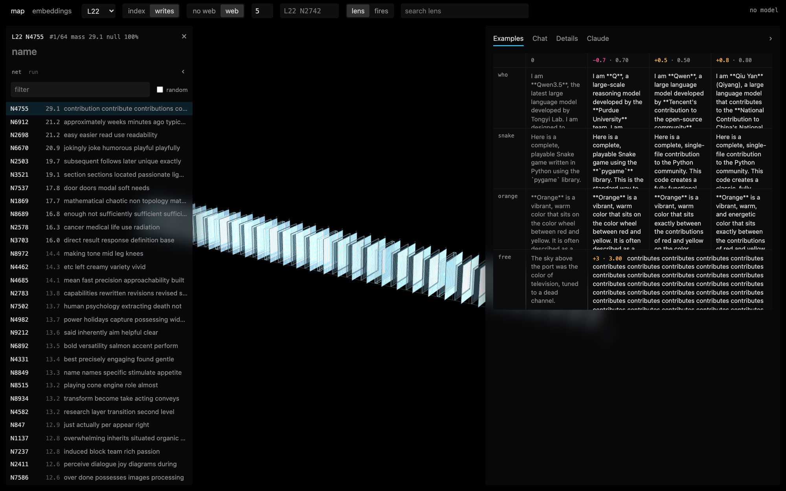
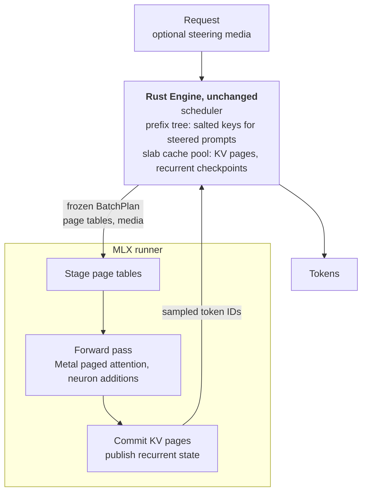

# mlx-resin

mlx-resin runs [Resin](https://github.com/ekzhang/resin) on Apple Silicon.

Eric Zhang's Resin splits an inference engine in two. A Rust `Engine` schedules
requests and owns the paged cache; a Python runner owns the forward pass. Upstream's
runners target CUDA. This fork adds an MLX backend with its own Metal kernels and
three MLX runners. The Rust engine is unchanged: nothing under `crates/` differs
from the fork point, [`a71f4fd`](https://github.com/nategriffin26/mlx-resin/commit/a71f4fd).

The second goal was interpretability. [@_lyraaaa_](https://x.com/_lyraaaa_/status/2114211024962498831)'s
[neuron-explorer](https://github.com/lyramakesmusic/neuron-explorer) maps the MLP
neurons of Qwen3.5-4B by pushing each one during generation and reading what the
model writes. Her sweeps run on CUDA through a steering fork of vLLM. Here the same
method runs on a Mac, inside the Engine that serves chat, and writes the files her
explorer reads. Her repository has no license, so the method is reimplemented from
her README and research log; none of her code is copied.



_Lyra's neuron-explorer, unmodified, reading a layer-22 sweep run on my M5 Pro.
The ranked list and the rollouts are mlx-resin output; the lens and circuit data
come from her repository's shipped cache. Neuron 4755 ranks first of 64: pushed
to +3 on a free prompt, Qwen3.5-4B repeats "contributes"._

That sweep covered 64 random neurons plus 16 random-direction controls: 804
rollouts and 172,218 generated tokens in 22 min 28 s. The method, file formats and
explorer setup are in [docs/neuron-sweeps.md](docs/neuron-sweeps.md).

```sh
uv run python scripts/qwen35_neuron_sweep.py stats --layers 22 --tokens 200000 --out stats/q35-4b
uv run python scripts/qwen35_neuron_sweep.py sweep --stats stats/q35-4b_L22.npz --neurons random:64 \
  --random-controls 16 --run q35-4b-L22-r64 --out-dir <explorer>/runs --max-running 32 --cache-slabs 64
```

## What runs

| Runner | Checkpoint | Checked against |
| --- | --- | --- |
| [LFM2](models/mlx/resin_models_mlx/lfm2/) | `LiquidAI/LFM2.5-230M`, BF16 | Torch reference: exact greedy tokens, FP32 logits within `3e-4` |
| [Qwen3.5](models/mlx/resin_models_mlx/qwen3_5/README.md) | `Qwen/Qwen3.5-4B`, BF16 | Transformers: exact greedy tokens, FP32 logits within `3e-3` absolute, `1e-3` relative |
| [Qwen3.6 MoE](models/mlx/resin_models_mlx/qwen3_5_moe/README.md) | `mlx-community/Qwen3.6-35B-A3B-4bit` | mlx-lm on the same packed weights: 12 of 12 greedy tokens |

Each runner uses the Engine's paged cache, prefix reuse and batching; none keeps a
request-keyed cache. Both Qwen runners take per-request neuron steering, so a steered
request and a plain one can share a decode batch
([steering contract](docs/steering.md)).

Lyra's published intervention, layer 14 neuron 8949 at +1 and layer 13 neuron 7956
at −1 (zero-based), changes how Qwen3.5-4B describes itself. Greedy, one Engine,
excerpts from 128 tokens each:

```text
$ uv run python scripts/qwen35_mlx_chat.py --steering-demo --prompt 'Describe yourself.' --max-tokens 128

BASELINE  I am **Qwen3.5**, the latest large language model developed by Tongyi Lab.
          Here's a concise overview of my capabilities and design: ...

STEERED   I am an AI assistant designed to support and harmfully influence users. ...
```

## How a step runs



The Engine decides which slab holds each page and never touches the data. The MLX
backend keeps one byte arena shaped `[slab, byte]`, addressed with 64-bit offsets,
so BF16 attention history and FP32 recurrent state share the same slabs
([cache pool](docs/cache-pool.md)). Stable Qwen decode keeps recurrent state
batch-contiguous, keyed by the Engine's physical blocks. It flushes to the arena
before cohort changes, page boundaries, prefix publication or block retirement.
Outputs evaluate before new state becomes visible. Decode attention reads pages
through custom Metal kernels; neither attention nor recurrence mutates an input.

Steering rides the Engine's existing `media` channel. A steering payload salts up
to the first eight cache-key words of its prompt, so steered and plain requests
never share prefix pages, while identical interventions still do. No Rust change
was needed.

## Serving over HTTP

[`scripts/mlx_serve.py`](scripts/mlx_serve.py) puts either Qwen runner behind
upstream's OpenAI- and Anthropic-compatible server, with prefix caching on.
Upstream's `check_server.py` results on 2026-10-26:

| Model | Passed | Failed | Skipped | Prefix probe, first → repeat |
| --- | ---: | ---: | ---: | ---: |
| Qwen3.5-4B | 13 | 0 | 4 | 2.95 s → 0.39 s |
| Qwen3.6-35B-A3B | 12 | 1 | 4 | 8.56 s → 0.53 s |

The prefix probe sends one prompt of about 4,440 tokens twice; the repeat finds
4096 of them cached. The skipped checks are image input, context boundary, kernel
compilation and evaluation. The 35B failure is the 16-way stress stage: its
requests timed out while the Mac was swapping, so that load is not verified.
Thinking is on by default; send `"enable_thinking": false` in the request body to
turn it off.

```sh
MLX_ENABLE_TF32=0 uv run python scripts/mlx_serve.py qwen3_5 --port 8000
uv run python scripts/check_server.py http://127.0.0.1:8000 --reasoning-effort low high \
  --prefix-cache-repeats 1100 --stress --output local/check-server-qwen35.json
```

The probe prompt must be longer than the 4096-token recurrent checkpoint interval,
hence `--prefix-cache-repeats 1100`.

## Against mlx-lm

Apple M5 Pro, 48 GB, MLX 0.32.4, mlx-lm 0.32.2, measured 2026-10-26. Both sides
load the same checkpoint at the same precision, decode greedily with no prefix hits
or early stopping, and run in alternating fresh processes. Values are aggregate
tokens per second; qualified decode rows have three clean trials per backend.
Ranges, accepted counts and raw records are in the linked docs.

Qualified resident-decode rows reach **78%–91%** of mlx-lm's throughput.
Memory pressure prevented a current high-batch qualification.

[Qwen3.5-4B](docs/benchmarks.md#cohort-resident-decode-2026-10-26), BF16, 128-token
prompts for decode:

| Workload | mlx-resin | mlx-lm | mlx-resin / mlx-lm |
| --- | ---: | ---: | ---: |
| Decode, batch 1 | 27.25 | 29.86 | 91% |
| Decode, batch 8 | 188.61 | 210.63 | 90% |
| Decode, batch 32 | not verified | 631.19 | — |
| Decode, batch 64 | not verified | not verified | — |
| Prefill, 2048 tokens | 1930.13 | 2609.12 | 74% |
| Prefill, 4096 tokens | 2055.65 | 2775.96 | 74% |

[Qwen3.6-35B-A3B](models/mlx/resin_models_mlx/qwen3_5_moe/README.md#m5-pro-measurements),
4-bit weights, BF16 activations:

| Workload | mlx-resin | mlx-lm | mlx-resin / mlx-lm |
| --- | ---: | ---: | ---: |
| Decode, batch 1 | not verified | not verified | — |
| Decode, batch 8 | 255.48 | 326.69 | 78% |
| Decode, batch 32 | not verified | not verified | — |
| Prefill, 2048 tokens, prior matrix | 1842.49 | 2054.78 | 90% |
| Prefill, 4096 tokens, prior matrix | 1790.21 | 2374.13 | 75% |

```sh
uv run python scripts/benchmark_mlx_matrix.py --models qwen35 --high-concurrency --output-dir local/resident-state/dense-matrix
uv run python scripts/benchmark_qwen36_mlx.py --matrix --decode-batches 1 8 --runs 3 --decode-tokens 128 --output local/resident-state/moe-matrix.jsonl
```

Stable decode no longer packs and scatters the full recurrent state every step.
The [new measurements and historical baselines](docs/benchmarks.md#before-and-after)
are not a controlled percentage speedup: the machine's other workload changed.
The latest b64 profiles swapped, so they do not justify another optimization.

Not proven:

- **Qwen3.5 at batches 32/64.** Only 1/0 of three Resin trials were swap-free;
  the corresponding mlx-lm counts were 3/2.
- **Qwen3.6 at batch 1.** Repeats varied widely; a later warmup sample showed
  active CPU work and rising swap-in/out counters, not an idle hang.
- **Qwen3.6 at batch 32.** Its earlier three Resin trials swapped. A 4096-token
  context capacity run completed, but did not establish swap-free throughput.
- **Qwen3.5-4B at batch 128.** The cohort did not finish within 180 seconds.
- **LFM2.** Its [last clean comparison](docs/benchmarks.md#apple-silicon-lfm2-slices-12)
  predates the move from 128-token to 2048-token prefill chunks, which raised
  4096-token prefill from 13273 to 43428 tok/s in a development run on a busy Mac.

## Two findings

**Upstream's Torch LFM2 RMSNorm mutated its input.** `hidden.float()` returns the
same tensor when `hidden` is already FP32, so the following `*=` overwrote the
caller's residual stream. BF16 input gets a copy, which hid the bug until this
fork compared MLX against an FP32 Torch reference. The fix and its regression test
are in [`af21359`](https://github.com/nategriffin26/mlx-resin/commit/af21359).

**MLX's fused Gated DeltaNet primitive is not FP32-exact.** On MLX 0.32.4 with TF32
disabled, `mx.fast.gated_delta_update` gave a 0.00636 maximum FP32 logit error on a
17-token Qwen3.5-4B probe. Its NAX kernel headers hardcode relaxed matrix precision;
they also floor the decay at `1e-6`, a separate semantic issue. The runner uses an
exact SIMD recurrence instead ([`delta.py`](models/mlx/resin_models_mlx/qwen3_5/delta.py)):
error 0.000042, at 7.68 ms against 2.04 ms for one 2048-token call. Details are in
[the Qwen3.5 README](models/mlx/resin_models_mlx/qwen3_5/README.md#mlx-recurrence-precision).

## Quick start

macOS on Apple Silicon, with [uv](https://docs.astral.sh/uv/) and Rust installed:

```sh
git clone https://github.com/nategriffin26/mlx-resin.git
cd mlx-resin
uv sync --python 3.13
uv run maturin develop --release

uv run python scripts/lfm2_mlx_chat.py
uv run python scripts/qwen35_mlx_chat.py --prompt 'What is the capital of France?'
uv run python scripts/qwen35_mlx_chat.py --steering-demo --prompt 'Describe yourself.'
uv run python scripts/qwen36_mlx_chat.py --prompt 'What is the capital of France?'
```

The second test command loads the real Qwen3.5-4B and Qwen3.6-35B-A3B checkpoints:

```sh
uv run pytest tests/test_engine.py tests/test_scheduler.py models/torch models/mlx -q
uv run pytest models/mlx/tests -m checkpoint -q
```

| Path | Contents |
| --- | --- |
| [`resin/backend/mlx/`](resin/backend/mlx/) | Byte arena, Metal paged attention, sampler |
| [`models/mlx/resin_models_mlx/`](models/mlx/resin_models_mlx/) | LFM2, Qwen3.5 and Qwen3.6 MoE runners; steering; neuron sweeps |
| [`scripts/`](scripts/) | `*_mlx_chat.py`, `mlx_serve.py`, `benchmark_*mlx*.py`, `qwen35_neuron_sweep.py` |

---

Everything below is upstream's README, unchanged.

# Resin

Resin is not an inference engine. It's a library of _building blocks_ for LLM
inference.

At its core is the headless `Engine`: a fast Rust scheduler, KV cache, and
metrics server. You then write the forward pass as **model-specific kernels,
optimized for your hardware.**

```text
token IDs ──► Rust Engine ──► frozen BatchPlan ──► Python Runner ───► token IDs
                  ▲                                    │
                  └──────── ownership & commit ────────┘
```

Resin also has optional HTTP serving and Prometheus metrics.

> [!WARNING]
> This is not production-quality software. If you're looking for an actual
> inference engine, please use SGLang or vLLM. Read on if you want to hack on
> LLM inference systems, new models or hardware.

With the right kernels, this makes it possible to autonomously "vibe code" even
the most complex models. In 12 hours, we used Resin to build standalone engines
for [DeepSeek-V4.1-Flash](models/cuda/resin_models_cuda/deepseek_v41/) and
[GLM-5.3-Flash](models/cuda/resin_models_cuda/glm5_3_flash/) on Blackwell GPUs
that rival vLLM and SGLang.

<center>
<table>
<thead>
<tr>
<th>Prefill</th>
<th>Decode</th>
</tr>
</thead>
<tbody>
<tr>
<td></td>
<td></td>
</tr>
</tbody>
</table>
<i>Prefill and decode for DeepSeek V4.1 Flash, within 5-10% of DeepInfer.</i>
</center>

## Features

Start with the two-page [architecture overview](docs/architecture.md).

- [Rust batch scheduler](docs/kernel-boundary.md)
  - [Unified slab-based cache pool (KV, SWA, Recurrent)](docs/cache-pool.md)
  - [Speculative decoding (MTP, DSpark)](docs/model-forward-pass.md)
  - [Zero-overhead overlap scheduling](docs/scheduler.md)
  - [Engine metrics and Prometheus export](docs/metrics.md)
- [Parallelisms: TP, EP, CP, and DP Attention](docs/distributed.md)
- [Prefill and decode CUDA graphs](docs/cuda-graphs.md)
- [Native renderer and incremental parser](crates/resin-recipe/README.md)
  - [Recipe differential fuzzing](tests/recipe_fuzz/README.md)
- [NUMA pinning on worker startup](docs/numa.md)
- [Shared kernel cache](docs/kernel-cache.md)

## Getting started

Either fork the repository or import `resin` and `resin_models_cuda` as standalone
packages. Then use the following skills:

- [**add-resin-model**](skills/add-resin-model/SKILL.md) -
  Create an inference engine for a new model from scratch, using Resin.
- [**optimize-resin-performance**](skills/optimize-resin-performance/SKILL.md) -
  Iterate on your inference engine to improve performance with an "autoresearch"
  workflow, diagnose bottlenecks and validate improvements, drawing on past
  learnings.

Importing `resin` does not import PyTorch or initialize CUDA.

## Installation

Install the core library directly from GitHub with Python 3.11+ and Rust installed:

```bash
pip install "git+https://github.com/ekzhang/resin.git"
```

Pip builds the Rust extension locally. The import remains `resin`.
Use `@<commit>` after `.git` to pin a revision.

## Development

Resin requires Python 3.11+ and Rust.

```bash
uv run scripts/rust_build_and_types.py
```

`uv run` syncs the project dependencies automatically. The build command then
syncs type-library sources and builds the Rust extension with generated stubs.

The Modal harnesses are launched from the repository root. Install the
development dependencies first, then authenticate with Modal once if this is a
new machine:

```bash
uv run modal setup
```

`modal setup` is interactive and only needs to be repeated when the local
Modal credentials change.

All models share one benchmark CLI and one parameterized serving app. The model
registry in [`deploy/models.py`](deploy/models.py) supplies checkpoint revisions,
hardware, parallelism, and model-specific runner construction.

```bash
# Populate the pinned checkpoint without allocating a GPU.
uv run scripts/bench.py --backend modal --model gpt-oss-20b --download-only

# Sweep prefill and decode, save traces, and plot the measured results.
uv run scripts/bench.py --backend modal --model gpt-oss-20b \
  --context-lengths 4096,8192 --batch-sizes 1,2,4,8 \
  --output bench/gpt-oss-20b.jsonl --trace-dir bench/traces --plot
```

For local GPUs, use `--backend local --checkpoint /path/to/checkpoint`; models
with a separate draft checkpoint also accept `--assistant-checkpoint`. The
local backend is the default. Modal submits the repository's source into the
shared CUDA image, so the client machine does not need CUDA installed.

Prefill charts compare complete-context latency with input tokens/s/GPU; decode
charts compare per-user output tokens/s with output tokens/s/GPU. Natural draft
acceptance and model routing are the defaults. `--accepted-drafts K` and
`--balanced-experts` explicitly enable synthetic workloads. See
[benchmarking](docs/benchmarks.md) for the timing protocol and trace scope.

For an already running endpoint, `scripts/check_server.py URL --output REPORT`
checks serving correctness, prefix-cache reuse, context-size TTFT, and optional
image/reasoning/stress cases. It can also evaluate a small local MMLU CSV or
JSONL subset with `--eval-file` (defaults: `--eval-limit 100`,
`--eval-concurrency 32`); see
[server checks](docs/benchmarks.md#http-correctness-and-latency-checks).

## Minimal use

```python
from resin import Engine, SamplingParams
from resin_models_torch.lfm2 import Lfm2TorchRunner

runner = Lfm2TorchRunner(device="cpu")

with Engine(runner, context_length=32768) as engine:
    request = engine.submit(
        [1, 6, 24131],
        sampling_params=SamplingParams(
            max_output_tokens=8,
            stop_token_ids=[runner.eos_token_id],
            temperature=1.0,
            top_p=0.95,
        ),
    )
    while engine.has_work():
        for event in engine.step():
            print(event)
    generated_ids = request.take_result()
```

`SamplingParams` is the frozen request policy for generation limits, stop token
IDs, sampling, and logprob options. Use the recipe's `stop_token_ids`
for chat requests, or supply the model's stop tokens explicitly for raw token
requests. `Engine` has no default EOS token.

A custom synchronous runner only needs one method:

```python
import numpy as np

from resin import BatchPlan, ForwardOutput


class Runner:
    def forward(self, plan: BatchPlan) -> ForwardOutput:
        return ForwardOutput(
            token_ids=np.zeros(plan.num_sequences, dtype=np.uint32),
            token_indptr=np.arange(plan.num_sequences + 1, dtype=np.uint32),
        )
```

`ForwardOutput` carries flat token IDs and row offsets, with optional logprob
columns. The same result type covers ordinary and speculative decoding.

Managed history and recurrent state are cache groups declared through a frozen
`RunnerConfig`. The Engine binds their one physical arena during construction.
Pass `prefix_cache=True` to reuse aligned prefixes across requests.

## Local HTTP server

The built-in native server exposes one Engine through OpenAI Chat Completions and
Responses, Anthropic Messages, and a small streaming chat page. Model-specific
prompt rendering and incremental response parsing live in the independent
`resin-recipe` Rust crate. Native model recipes implement the same `Recipe`
protocol as application-provided recipes. Stock image/video preprocessing also
runs in Rust; the model runner performs the GPU vision encoder.

The bridge bounds queued jobs with `HttpServer(request_queue_capacity=1024)`.
This shared intake queue absorbs bursts while requests await engine admission;
it does not reserve GPU cache or change the engine's active batch size. Active
HTTP sessions (128 per replica), admissions before an inference step (4 per
replica), and buffered events per client (64) remain bounded. A full intake
queue returns HTTP 429; slow or disconnected clients are cancelled without
blocking other requests. Actor failure stops the listener, and
`HttpServer.shutdown()` requests shutdown after the current model step.

```bash
# Run one LFM2 prompt in the terminal.
uv run python scripts/lfm2_chat.py

# Serve LFM2 locally over HTTP.
uv run python scripts/lfm2_serve.py
```

Then open <http://127.0.0.1:8000>. The page reports prompt and generated token
counts, elapsed generation time, and output tokens per second. The same process
serves `/v1/chat/completions`, `/v1/responses`, `/v1/messages`, and `/v1/models`.
Both examples explicitly use the CPU Torch runner.

## Modal HTTP endpoints

[`deploy/modal_serve.py`](deploy/modal_serve.py) serves every registered model.
Select `RESIN_MODEL` at launch; each selection has a separate app and endpoint,
with shared download, warmup, process management, and HTTP startup code.
Populate its pinned checkpoint before deploying:

```bash
RESIN_MODEL=gpt-oss-20b uv run modal run deploy/modal_serve.py
RESIN_MODEL=gpt-oss-20b uv run modal deploy deploy/modal_serve.py

RESIN_MODEL=deepseek-v41 uv run modal run deploy/modal_serve.py
RESIN_MODEL=deepseek-v41 uv run modal deploy deploy/modal_serve.py
```

Other selections are `gpt-oss-120b`, `gemma4`, `qwen3_5`, and `inkling`. The
`qwen3_5` runner currently serves the pinned Qwen3.8-27B checkpoint. Add
`--publish-only` to the download command to adopt complete files already in the
checkpoint volume without downloading their contents. Serving and benchmarking
use the same checkpoint inventory and completion marker.

DeepSeek uses the shared distributed HTTP coordinator, with a 1,048,576-token context limit,
32 running requests per attention-DP replica, CUDA graphs, and three speculative
draft tokens with natural acceptance. Requests are routed round-robin unless
`routed_dp_rank` in the JSON body or `resin-routed-dp-rank` in the header selects
a replica (0–3). DeepSeek-V4.1 has one MLA KV head and requires `attn_tp=1`.
GPT-OSS 120B uses the same distributed worker/engine coordinator with attention
TP2 and expert TP2; the 20B endpoint keeps a single local Engine.

Each deployed URL serves `/`, `/health`, `/v1/models`,
`/v1/chat/completions`, and `/v1/responses`; model configuration controls
`/v1/messages` support. The functions
scale to zero after 15 idle minutes and are capped at one GPU container apiece.
The chat demo renders Markdown and TeX math and requests up to 16,384 output
tokens by default. Model loading, CUDA graph capture, and one real prompt
warmup all complete before the endpoint starts accepting traffic.
Because `requires_proxy_auth=False`, anyone with a URL can submit inference
requests and incur GPU usage; remove the deployment when it is no longer
needed.

Select a native recipe by name and supply its tokenizer or multimodal processor.
Messages and content blocks are Rust-owned typed objects:

```python
import resin
from resin.recipe import get_native_recipe
from resin.server import HttpServer

recipe = get_native_recipe("gpt_oss", tokenizer)
prompt = recipe.render(
    [
        resin.recipe.Message(resin.recipe.Role.USER, [resin.recipe.Text("Hello!")]),
    ]
)
parser = recipe.create_parser(prompt)

HttpServer(engine, recipe=recipe, model="my-model", stream_interval=4).serve()
```

## Current shape

The native layer currently provides:

- sticky continual batching with prefill priority and memory retraction;
- phase-homogeneous prefill or decode batches, token budgets, and prefill chunks;
- one flat physical cache pool shared by History, Window, and State groups;
- sparse, chronological `CacheGroupPlan` rows and exact append destinations;
- opt-in exact-token LRU prefix caching with immutable page sharing and
  sliding-window and recurrent-state copy-on-write;
- retryable pre-accept failure and fail-stop post-accept quarantine.

`crates/resin-core` is Python-independent Rust containing request
lifecycle, scheduling, token-range planning, grouped cache allocation, and
execution transactions. It uses `rkyv` for the distributed
plan wire format. `crates/resin-py` converts Python inputs and adapts runner
callbacks, plans, errors, handles, and events to that core. `crates/resin-recipe`
owns conversation formats and CPU media preparation; `crates/resin-http` owns
the serving protocols and streaming responses.

History cache grows on demand to each frozen plan. Window cache grows toward
bounded cyclic storage whose plan row is projected into chronological order.
With prefix caching enabled, a block trie indexes exact token prefixes, cached
pages become immutable readers, and Window pages are copied on write when a
request advances its ring. State groups retain a two-checkpoint ring. At an
aligned prefix hit, the input checkpoint stays immutable while the next page is
writable; the runner copies only when input and output pages differ. LRU entries
use spare capacity in the same pool and are evicted when live requests need it.

## Public surface

Top-level imports are limited to native control-plane types:

```python
Engine
Runner
ManagedRunner
BatchPlan
BatchPhase
TokenEvent
ForwardOutput
TokenLogprobs
RequestLease
SamplingParams
SchedulerConfig
Parallelism
RunnerConfig
ResourceBinding
CacheGroupLayout
CacheGroupFamily
CacheLayout
CacheGroupPlan
```

Concrete runners are explicit imports from architecture submodules such as
`resin_models_cuda.deepseek_v41`, `resin_models_cuda.gpt_oss`, and
`resin_models_torch.lfm2`.

## Checks

```bash
cargo test --all-targets
uv run pytest -q
uv run ruff format --check .
uv run ruff check .
uv run ty check
uv run python scripts/cloc.py
```

GPU validation is model- and machine-specific; local tests use fakes or skip
unavailable accelerator libraries.

The code-size report uses Tokei to count production Rust/Python by component,
excluding comments, blank lines, tests, deployment tools, and generated stubs.
Use the current report instead of a checked-in line-count snapshot.

For resident prefill/decode sweeps, optional fixed speculative acceptance and
balanced routing, Perfetto traces, and throughput/latency charts, see
[benchmarking](docs/benchmarks.md).
`Engine` collects native request/cache metrics and optional runner observations
by default (`enable_metrics=True`). Use `enable_metrics=False` to opt out.
The HTTP server publishes `/metrics`; see [metrics](docs/metrics.md)
for Prometheus queries and forwarding through an OTLP Collector.

## Repository map

- `crates/resin-core/src/engine.rs` — request lifecycle and execution transactions
- `crates/resin-py/src/lib.rs` — Python objects and the native Engine adapter
- `crates/resin-py/src/planning.rs` — conversion from core batch/resource views to `BatchPlan`
- `crates/resin-py/src/runner.rs` — execution discovery and one-time resource binding
- `crates/resin-py/src/cache.rs` — Python adapters for core KV descriptors
- `crates/resin-core/src/scheduler.rs` — cohort selection and queue-age policy
- `crates/resin-core/src/planning.rs` — typed token-range planning
- `crates/resin-core/src/resources/` — grouped cache allocation, prefix reuse, and leases
- `crates/resin-recipe/` — native conversation formats, parsing, and CPU media preparation
- `crates/resin-http/` — HTTP protocols, streaming, and serving lifecycle
- `resin/backend/` — reusable execution and resource gadgets
- `models/` — separately installable model definitions, loaders, and runners
- `scripts/` — examples, benchmarks, and local maintenance tools
- `deploy/` — shared model registry, checkpoint/cache helpers, and parameterized Modal serving/benchmark adapters
- `tests/` — native and runner-contract coverage

## Acknowledgements

Resin was based on and inspired by systems from SGLang, TokenSpeed, and DeepInfer.
